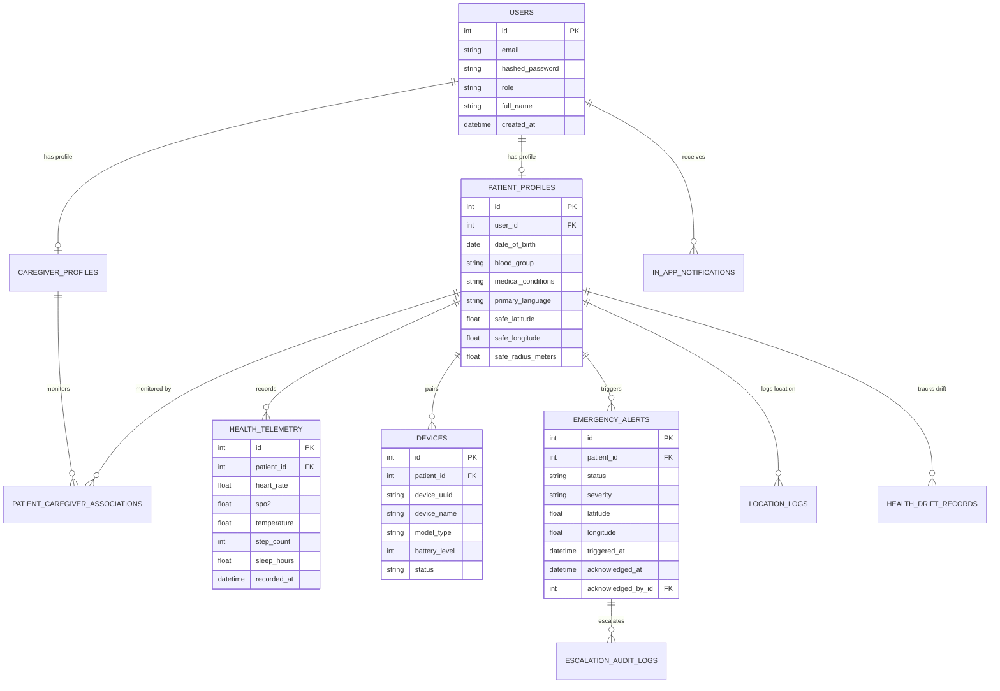

# PulseGuardian AI — Complete System Architecture & Engineering Specification

This document provides a comprehensive technical overview of the architecture, data models, communication protocols, and algorithmic pipelines implemented in the **PulseGuardian AI: Smart Wearable Health Monitor**.

---

## 1. High-Level Architecture Diagram

```mermaid
flowchart TD
    subgraph EdgeDevice["Edge & Wearable Layer"]
        ESP32["ESP32 Microcontroller"]
        MAX30102["MAX30102 Optical PPG Sensor (HR & SpO2)"]
        IMU["MPU6050 / Accelerometer (Steps & Activity)"]
        BLE["BLE GATT Service"]
        WIFI["Wi-Fi HTTP Client"]
        MAX30102 --> ESP32
        IMU --> ESP32
        ESP32 --> BLE
        ESP32 --> WIFI
    end

    subgraph BackendCore["FastAPI Backend Services Layer (Python 3.13)"]
        Gateway["Uvicorn ASGI Server / CORS Middleware"]
        AuthRouter["Auth Router (JWT / Bcrypt RBAC)"]
        HealthRouter["Health & Telemetry Router"]
        ECGStream["ECG DSP Simulation Stream (/health/ecg/stream)"]
        VoiceRouter["Voice & WebSocket Router (/voice/ws)"]
        GeofenceService["Geofence Engine (Haversine Formula)"]
        EscalationLadder["Emergency SOS Escalation Ladder"]
        AIDigitalTwin["AI Digital Twin & Drift Analysis (EWMA / Isolation Forest)"]
        Adapters["Adapters (Whisper STT / OpenAI Translation / TTS)"]

        Gateway --> AuthRouter
        Gateway --> HealthRouter
        Gateway --> ECGStream
        Gateway --> VoiceRouter
        HealthRouter --> GeofenceService
        HealthRouter --> EscalationLadder
        HealthRouter --> AIDigitalTwin
        VoiceRouter --> Adapters
    end

    subgraph DataStorage["Data Persistence Layer"]
        SQLite["SQLite (pulseguardian.db) / PostgreSQL"]
        Alembic["Alembic Database Migrations"]
        Tables["Tables: users, patient_profiles, caregiver_profiles, health_telemetry, emergency_alerts, devices, health_drift_records, in_app_notifications"]
        SQLite --- Tables
        Alembic --> SQLite
    end

    subgraph FrontendApp["Frontend Application Layer (React 19 + TypeScript + Vite)"]
        AuthContext["Auth Context & Token Storage"]
        WSContext["WebSocket Context (Reconnection & Ping/Pong)"]
        Dashboard["Patient Dashboard & Vitals Widgets"]
        ECGView["Live ECG Waveform Canvas (Lead I 250Hz)"]
        SOSView["Emergency SOS Press & Hold Trigger (2.0s)"]
        CaregiverView["Caregiver Portal & Alert Ack Dashboard"]
        GPSView["GPS Safe Zone Geofence Map View"]
        VoiceWidget["Voice Assistant Modal / Streaming Audio"]
    end

    WIFI -- "HTTP POST Batch Telemetry" --> HealthRouter
    BackendCore --- SQLite
    FrontendApp -- "REST APIs (Axios Bearer Token)" --> Gateway
    WSContext <-- "Bi-directional WebSocket" --> VoiceRouter
```



---

## 2. Layered Backend Design

The backend is built around clean architectural boundaries:

```
backend/
├── app/
│   ├── main.py                  # ASGI FastAPI application entrypoint, CORS & middleware
│   ├── core/
│       ├── config.py            # Pydantic v2 BaseSettings configuration from .env
│       ├── security.py          # Password hashing (bcrypt) and JWT encode/decode
│       └── database.py          # SQLAlchemy 2.0 engine, SessionLocal, Base model
│   ├── models/                  # SQLAlchemy ORM entity models
│       ├── user.py              # User account model (patient & caregiver roles)
│       ├── profile.py           # PatientProfile, CaregiverProfile, Associations
│       ├── telemetry.py         # HealthTelemetry, Devices, DeviceConnectionHistory
│       ├── emergency.py         # EmergencyAlert, EscalationAuditLog
│       ├── location.py          # LocationLog, Geofence configuration
│       └── notification.py      # InAppNotification, Audit logs
│   ├── schemas/                 # Pydantic request/response validation schemas
│   ├── api/v1/                  # API routers grouped by domain
│       ├── auth.py              # Login, Register, Profile, Token Refresh
│       ├── health.py            # Telemetry ingestion, ECG stream, Geofence check, SOS
│       ├── voice.py             # Voice query, WebSocket /ws, Audio validation
│       └── devices.py           # Device pairing, status, heartbeats
│   ├── services/                # Pure business logic services
│       ├── drift_service.py     # EWMA calculation, baseline deviation, drift status
│       ├── geofence_service.py  # Haversine great-circle calculation & breach check
│       ├── escalation.py        # SOS multi-stage caregiver escalation ladder
│       └── voice_service.py     # Whisper transcription, translation, TTS orchestrator
│   └── adapters/                # Third-party integration adapters
│       ├── whisper_adapter.py   # OpenAI Whisper API HTTPX client + Mock fallback
│       ├── translation_adapter.py # Multilingual clinical translation adapter
│       └── tts_adapter.py       # Text-to-speech audio synthesis adapter
└── tests/                       # 175 passing unit, integration, and E2E pytest tests
```

---

## 3. Database Entity Relationship (ER) Model



---

## 4. Key Algorithmic Pipelines

### 4.1 Physiological Health Drift Pipeline
```
Raw Telemetry Point
       │
       ▼
14-Day Rolling Baseline Calculation (Mean μ, Std Dev σ)
       │
       ▼
Compute EWMA (Exponential Smoothing, α = 0.25)
       │
       ▼
Compute Z-Score: Z = (EWMA - μ) / σ
       │
       ├─► |Z| ≤ 1.0  ──► Status: Baseline Stable
       ├─► 1.0 < |Z| ≤ 2.0  ──► Status: Mild Physiological Drift (Yellow Warning)
       └─► |Z| > 2.0  ──► Status: Significant Anomaly (Red Alert & Caregiver Notification)
       │
       ▼ (If samples ≥ 30)
Multivariate Isolation Forest (sklearn) identifies multi-parameter outlier vectors
```

### 4.2 Emergency SOS Escalation Ladder
```
SOS Event Triggered (Press-and-Hold 2.0s)
       │
       ▼
Stage 1: Alert Created (status: 'triggered')
       ├─► Immediate In-App notification to Primary Caregiver
       └─► Start 3-minute unacknowledged timer
       │
       ▼ (T + 3 mins: Still unacknowledged)
Stage 2: Escalate to Secondary Caregivers & Family Contacts
       └─► Start 4-minute unacknowledged timer
       │
       ▼ (T + 7 mins: Still unacknowledged)
Stage 3: Dispatch Critical Emergency Medical Service Notification
       │
       ▼ (At any moment caregiver clicks 'Acknowledge')
State Transition: status ──► 'acknowledged'
       └─► Escalation timer halts; resolution timestamp recorded
```

---

## 5. Security & Privacy Architecture

1. **Password Encryption**: PBKDF2/Bcrypt with random salt generation.
2. **Access Control**: Role-Based Access Control (RBAC) enforced via FastAPI dependency injection:
   - `require_patient`: Ensures only patient accounts access self-telemetry and personal devices.
   - `require_caregiver`: Restricts access to assigned patient lists, SOS acknowledgement, and clinical communications.
3. **Data Sanitization & Validation**: Strict Pydantic models eliminate SQL injection and type confusion vulnerabilities.
4. **WebSocket Protection**: Handshake verification using JWT query tokens to protect streaming voice and telemetry channels.
